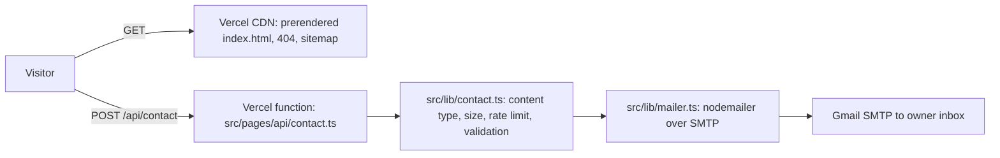

# Sabin Khanal: Portfolio

[](https://github.com/Sabin78910/Portfolio/actions/workflows/ci.yml)

Live: **[sabinkhanal13.com.np](https://sabinkhanal13.com.np)**

A single-page professional portfolio built with Astro and deployed on Vercel. The page is prerendered HTML that works without JavaScript; a small amount of vanilla TypeScript adds a WebGL particle hero, form validation and offline support. One server route, `POST /api/contact`, validates messages and delivers them by SMTP. All profile content comes from one data file, and the build adds a strict Content Security Policy whose script hashes are computed from the built HTML. Research, security testing and measured results are recorded in [AUDIT.md](AUDIT.md).

## Features

- Sections for about, experience, education, projects and contact, all rendered from `src/data/profile.ts`.
- WebGL particle hero written in raw WebGL 1 with no library. It falls back to a static poster for reduced-motion users, Save-Data, devices without WebGL, low-core or low-memory devices and software renderers, and a Play/Pause motion control is remembered per visitor.
- Contact form that works as a plain HTML form post and as a `fetch()` call, with per-field error messages and a honeypot field.
- Installable as a web app (manifest plus service worker): network-first for pages, stale-while-revalidate for assets, and the API never cached.
- Search metadata: canonical URL, Open Graph image, JSON-LD `WebSite` and `ProfilePage` with a `Person`, and a generated sitemap whose `lastmod` comes from the last git commit that touched profile content.
- Google Analytics loads only after the visitor accepts the cookie banner, and withdrawing consent deletes its cookies.

## Architecture



- `src/pages/index.astro` builds the page from `src/data/profile.ts`; `src/layouts/Base.astro` holds the document shell, metadata and cookie banner.
- Browser code in `src/scripts/` is kept thin; the decisions it relies on (hero mode, consent parsing) live as pure functions in `src/lib/` so they can be unit-tested.
- `scripts/security-headers.mjs` runs after `astro build` and writes the security headers into the Vercel build output.

## Tech stack

| Area | Choice |
|---|---|
| Framework | Astro 7 with the `@astrojs/vercel` adapter |
| Language | TypeScript (vanilla, no UI framework) |
| Styling | Plain CSS with design tokens; Geist via the Astro Fonts API |
| Email | nodemailer |
| Analytics | Vercel Analytics; Google Analytics 4 behind consent |
| Tests | `node:test` |
| Hosting | Vercel |

## Getting started

Prerequisite: Node.js 22.18 or later.

```bash
npm install
npm run dev      # http://localhost:4321, includes /api/contact
npm test         # node:test suites in src/lib
npm run build    # astro build, then security headers; output in .vercel/output
npm run preview
```

### Environment variables

Only needed for the contact form to send email. Without them the API answers 503.

| Variable | Purpose | Default |
|---|---|---|
| `SMTP_USER` | SMTP account and sender address | none |
| `SMTP_PASS` | SMTP password (Gmail app password; spaces are stripped) | none |
| `CONTACT_TO` | Inbox that receives messages | none |
| `SMTP_HOST` | SMTP server | `smtp.gmail.com` |
| `SMTP_PORT` | SMTP port (TLS when 465) | `465` |

Deployment steps for Vercel and the custom domain are in [DEPLOY.md](DEPLOY.md).

## Project structure

| Path | Contents |
|---|---|
| `src/data` | `profile.ts`: every fact shown on the site |
| `src/pages` | Home page, 404, `sitemap.xml` and the `api/contact` route |
| `src/layouts` | Base HTML layout |
| `src/components` | Icon and project-visual components |
| `src/lib` | Testable logic (contact validation, rate limit, mailer, consent, hero mode, last-modified date) and its tests |
| `src/scripts` | Browser scripts: interactions, consent banner, WebGL hero |
| `src/styles` | Global stylesheet and design tokens |
| `public` | Service worker, manifest, icons, CV PDF, `robots.txt`, `.well-known/security.txt` |
| `scripts` | Post-build security-header script |
| `cv` | HTML source of the CV |
| `.github/workflows` | CI, CodeQL and IndexNow workflows |

## Testing and CI

- Unit and route tests use Node's built-in `node:test` runner and live next to the code in `src/lib/*.test.ts`. They cover input validation, rate limiting, the contact route's responses, attack payloads (injection, XSS, header injection, oversized bodies, prototype pollution), mailer configuration, consent parsing, hero mode and the sitemap date.
- **CI** (`ci.yml`): on pushes to `main` and on pull requests, runs `npm ci`, `npm test` and `npm run build` on Node 24 with read-only permissions.
- **CodeQL** (`codeql.yml`): JavaScript and TypeScript analysis on pushes, pull requests and a weekly schedule.
- **IndexNow** (`indexnow.yml`): notifies search engines after a successful production deployment.
- All third-party actions are pinned to commit SHAs.

## Security notes

- The contact route is the only trust boundary. It accepts only `application/json` and `application/x-www-form-urlencoded`, caps the body at 64 KiB while streaming, and relies on Astro's origin check against cross-site form posts.
- Validation strips control and invisible characters, enforces length limits (name 100, email 254, message 5,000 characters) and checks email addresses against a strict pattern, so the reply-to header cannot carry extra recipients.
- A per-IP rate limit allows 5 messages per 10 minutes, groups IPv6 clients by /64 and is bounded in memory. Honeypot submissions get a fake success response.
- Email bodies are plain text only, and SMTP credentials come from environment variables; `.env` files are git-ignored.
- `scripts/security-headers.mjs` sets a Content Security Policy with hashed inline scripts and Trusted Types, plus HSTS, `X-Frame-Options: DENY`, `nosniff`, a restrictive Permissions-Policy and same-origin COOP and CORP. A `security.txt` file gives a disclosure contact.

## Design decisions and limitations

- Astro with static output keeps the page fast and readable without JavaScript; only the contact route runs on the server.
- The rate limit lives in memory, so each serverless instance counts separately. AUDIT.md recommends a Vercel WAF rule for a shared limit.
- Contact email depends on a Gmail app password. If it is revoked, the form returns 502 until `SMTP_PASS` is updated and the site is redeployed.
- On 15 October 2026 the live site scored 100 in all four Lighthouse 13.5 mobile categories with CLS 0 (AUDIT.md). These are lab results; a low-traffic site may never collect field data.
- When cached files change, `VERSION` in `public/sw.js` must be bumped so returning visitors get the new files.

## Author

**Sabin Khanal**. [Portfolio](https://sabinkhanal13.com.np) · [LinkedIn](https://www.linkedin.com/in/sabin-khanal-950163326) · [GitHub](https://github.com/Sabin78910)
